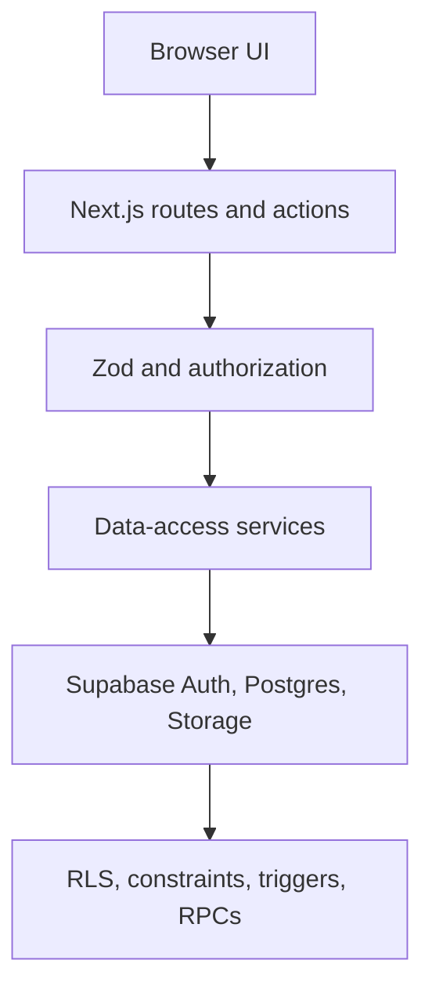
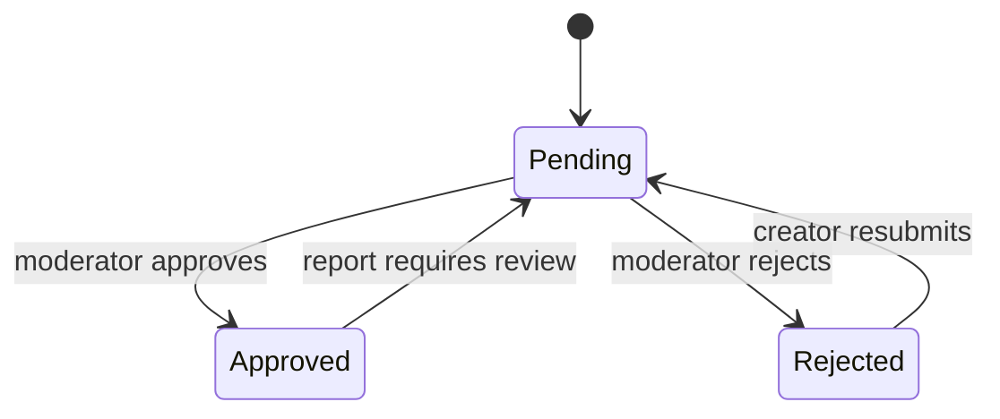

# Agent Souq — Architecture

## Architecture goals

The architecture keeps public discovery fast, private operations identity-safe, and future commerce or moderation additive. Next.js owns rendering and trusted application orchestration; Supabase owns authentication, relational integrity, authorization, and durable state. UI components do not query tables directly, and browser input is validated again at every trusted boundary.

## Technology stack

| Layer | Choice | Responsibility |
| --- | --- | --- |
| Application | Next.js 16 App Router, React 19, strict TypeScript | Server-rendered routes, metadata, route handlers, server actions, progressive interaction |
| Styling and UI | Tailwind CSS 4, Radix primitives, CVA, Lucide, Geist, next-themes | Responsive design system, accessible interaction primitives, themes, self-hosted typography |
| Validation | Zod | Query, form, action, and environment parsing with field-level errors |
| Identity | Supabase Auth with `@supabase/ssr` | Email/password, callbacks, password recovery, signed session cookies, verified server claims |
| Data | Supabase PostgreSQL | Marketplace records, relationships, full-text search, counters, RPCs, constraints, triggers, and RLS |
| Media | Supabase Storage plus HTTPS external-image support | Creator-owned listing images with runtime-safe visual fallback |
| Tests | Vitest, Testing Library, local Supabase tests | Unit/component behavior, API contracts, validation, and authorization invariants |
| Delivery | npm scripts and GitHub Actions | Lint, type checking, tests, database reset/security checks, and production build |

No paid dependency is required for local operation. Vercel is a convenient deployment target, not an application dependency.

## Application boundaries



- **Routes and components** render view models and submit typed user intent. They never supply trusted ownership fields.
- **Server actions and route handlers** parse inputs, authenticate, authorize, invoke a data operation, normalize errors, and revalidate affected paths.
- **Data-access modules** own database selects and convert database rows into domain types. Demo data is injected at this boundary, keeping components mode-agnostic.
- **PostgreSQL policies and functions** are the final authorization boundary. They derive identity from `auth.uid()`, atomically maintain counters, and reject incomplete state transitions.

## Source organization

The intended directory shape follows the boundaries already established in `src`:

```text
src/
  actions/             authenticated mutation orchestration
  app/                 routes, layouts, handlers, metadata, loading/error states
  components/          reusable primitives and product compositions
  lib/
    data/              queries, row mapping, demo adapter
    supabase/          browser/server/proxy clients
    auth.ts            verified-user/profile/creator guards
    validation.ts      shared Zod contracts
    errors.ts          safe application error vocabulary
  types/               framework-independent domain types
supabase/
  migrations/          versioned schema, functions, grants, policies
  seed.sql             deterministic local product data
docs/                  product, acceptance, architecture, security, setup
```

Server Components are the default. Client Components are restricted to browser-only interactions such as form state, theme controls, menus, image failure handling, and optimistic action feedback.

## Runtime modes

| Mode | Selection | Behavior |
| --- | --- | --- |
| `demo` | `NEXT_PUBLIC_DEMO_MODE=true`, or an unconfigured local development environment | Uses curated in-process catalogue/dashboard fixtures; authenticated mutations return a clear read-only error |
| `supabase` | Valid Supabase URL plus publishable/anon key | Uses Auth, Postgres, RPCs, RLS, and persistent user state |
| `misconfigured` | Partial configuration, explicit demo false without credentials, or missing production credentials | Fails explicitly with a service/configuration error; never presents demo state as production data |

Only loopback HTTP Supabase URLs are allowed outside production; other service and media URLs must use HTTPS.

## Domain model

| Entity | Purpose and key relationships |
| --- | --- |
| `profiles` | One-to-one with `auth.users`; member/creator/admin role, public identity, onboarding state, reserved trust/suspension fields |
| `categories` | Controlled marketplace taxonomy; one category has many agents |
| `agents` | Creator-owned listing, lifecycle and moderation state, pricing, content, normalized arrays, media URLs, search vector, and read-only aggregates |
| `favorites` | Unique `(user_id, agent_id)` saved relationship |
| `installations` | Unique member entitlement relationship; MVP function admits published free listings only |
| `reviews` | One review per `(user_id, agent_id)`, 1–5 stars; requires installation and blocks self-review |
| `recently_viewed` | Unique member/listing history with a refreshed timestamp used for private dashboard order and view deduplication |
| `reports` | Admin-ready report intake with status and moderator fields; no full moderation console in the MVP |
| Storage objects | Creator-path-owned listing images; URL references remain on the listing |

Computed listing values (`average_rating`, `review_count`, `favorite_count`, `install_count`, and `view_count`) are maintained by database functions/triggers rather than accepted from ordinary client updates.

## Authentication and authorization

1. The session proxy refreshes Supabase cookies and redirects unauthenticated protected requests to sign-in with a sanitized relative return path.
2. Server code calls verified claims to resolve the current subject. It does not authorize by a cookie value or request user ID alone.
3. A missing `profiles` row is recovered with a safe generated member profile.
4. User-level actions require authentication; creator mutations additionally require completed onboarding and a creator/admin profile.
5. Each data mutation is still constrained by RLS or a security-definer RPC with explicit ownership checks.

The application guard improves UX; RLS is the enforcement boundary. Service-role credentials are never used in the browser and are unnecessary for ordinary application requests.

### Public and private routes

- Public: landing, marketplace, listing details, creator storefronts, authentication screens, callbacks, public metadata, and marketplace APIs.
- Authenticated: onboarding, member dashboard, private interactions, and review management.
- Creator-only: listing creation, editing, lifecycle changes, unpublished previews, and creator analytics.

Protected responses use `private, no-store` caching and vary by cookie. Public listing queries explicitly filter to `published` plus `approved` even where RLS also enforces public visibility.

## Validation and state changes

Zod contracts provide fast field feedback and typed values. PostgreSQL checks repeat critical invariants so direct API access cannot bypass them:

- bounded text and pagination;
- normalized, unique tags and capabilities;
- HTTPS URL arrays and at most five gallery visuals;
- `free` means zero price; paid display types require positive cents;
- semantic listing version;
- 1–5 review score;
- valid lifecycle and moderation combinations.

State transitions use database functions (`publish_agent`, `return_agent_to_draft`, and `archive_agent`) so authorization, completeness, and timestamps are atomic. The initial publication timestamp is database-owned and preserved. Archived listings are terminal for the MVP.

Favorites are an intentional toggle. Free install uses `ON CONFLICT DO NOTHING`, making repeat submission idempotent. Review upsert preserves one review per member and listing; review eligibility is checked in the database transaction.

## Query and search design

Marketplace input is bounded before query construction: keyword length 100, page up to 10,000, and page size up to 48. An invalid public API query produces HTTP 400 rather than silently discarding user input.

The search RPC covers listing text, tags, capabilities, category, and creator identity, returns a total count, and applies the same lifecycle/moderation visibility filter as non-search queries. Every sort includes a stable unique ID tie-breaker. Requested pages beyond the result set clamp to a valid page.

Frequently read listing data is selected as a joined view model. Creator, category, and interaction dashboards use bounded result sets. Recommended indexes cover public status/moderation ordering, creator ownership, category, search vector, and composite interaction keys.

## Errors and action contracts

Application failures use a small safe vocabulary such as `BAD_REQUEST`, `UNAUTHENTICATED`, `FORBIDDEN`, `NOT_FOUND`, `CONFLICT`, `READ_ONLY_DEMO`, `CONFIGURATION_ERROR`, and `INTERNAL_ERROR`. Server actions return a serializable `ActionState` with success, message, optional field errors, and optional data. Route handlers return the corresponding normalized JSON and HTTP status.

Raw provider messages, SQL errors, stack traces, and record-existence signals do not cross the server boundary. Expected validation and authorization failures are presented inline; unexpected failures go to route error boundaries and operational logs.

## Security and privacy posture

- Least-privilege grants and RLS apply to tables, RPCs, and storage.
- Owner/reviewer identities come from the active subject; no client user ID is trusted.
- Anonymous reads receive storefront-safe profile fields only.
- Moderation, verification, suspension, publication timestamp, counters, and ownership are system-controlled.
- Password reset and sign-up responses resist account enumeration.
- Safe-return parsing blocks open redirects and ambiguous slash/backslash paths.
- External listing URLs are HTTPS-only, and failed media has a runtime fallback.
- Standard response headers prevent framing, MIME sniffing, unnecessary referrer leakage, and unnecessary device permissions.
- No secrets are committed; `.env.example` documents public configuration only.

Content submitted by creators is rendered as text, not trusted HTML. A stricter deployment Content Security Policy and rate limiting are recommended before public-scale traffic, because allowed image domains and hosting integrations are deployment-specific.

## Performance, accessibility, and localization

- Public catalogue and detail routes render on the server and use bounded queries.
- Images declare dimensions/aspect ratios, load responsively, and degrade without layout breakage.
- Loading boundaries provide immediate structure; empty and error states retain a next action.
- Reusable controls preserve native semantics, visible focus, labelled fields/errors, and keyboard operation; motion respects user preferences.
- Design tokens and self-hosted Geist avoid remote font runtime dependency.
- UI copy is centralized by composition where practical; logical CSS properties, adaptable card grids, and no hard-coded left/right meaning keep future RTL feasible.
- Locale, translated taxonomies, and localized currency formatting can be introduced without changing ownership or catalogue relationships.

## Admin-ready extension

The MVP reserves `admin` role, moderation state, featured ranking fields, report records, suspension metadata, and system-only update paths. A later moderation service can add an admin route group and audited RPCs without giving creators access to trust fields.

Recommended moderation flow:



Admin actions should record actor, reason, previous state, and timestamp in an append-only audit table before a public moderation UI is shipped.

## Payment-ready extension

Price type and cents describe an offer, not an entitlement. Payment integration should add separate entities rather than overloading `installations`:

| Future entity | Responsibility |
| --- | --- |
| `products` / `prices` | Immutable provider-linked commercial versions of an agent offer |
| `orders` | One-time purchase state, amount/currency snapshot, buyer, and provider references |
| `subscriptions` | Provider subscription lifecycle and period dates |
| `entitlements` | The canonical right to use/install an agent, sourced from free install, order, grant, or active subscription |
| `payment_events` | Idempotent webhook receipt and processing state |
| `creator_payout_accounts` | Provider onboarding state, never raw banking credentials |

Webhooks—not browser redirects—must grant paid entitlements. Provider event IDs need unique constraints, prices must be snapshotted server-side, and cancellation/refund rules must update entitlement status transactionally. Until this exists, paid listing actions remain visibly unavailable.

## Deployment and evolution

A deployable release requires configured site URL, Supabase public values, production migrations, Auth redirect allow-lists, storage policy verification, and passing `npm run verify`. Database changes are forward migrations; production seed data is not applied automatically.

Likely next increments, in order, are: moderation/report triage, transactional payment plus entitlements, creator media uploads, rate limiting/abuse protection, product analytics and audit logs, then localization. Each increment extends the existing boundaries instead of bypassing RLS or placing business rules in UI components.
