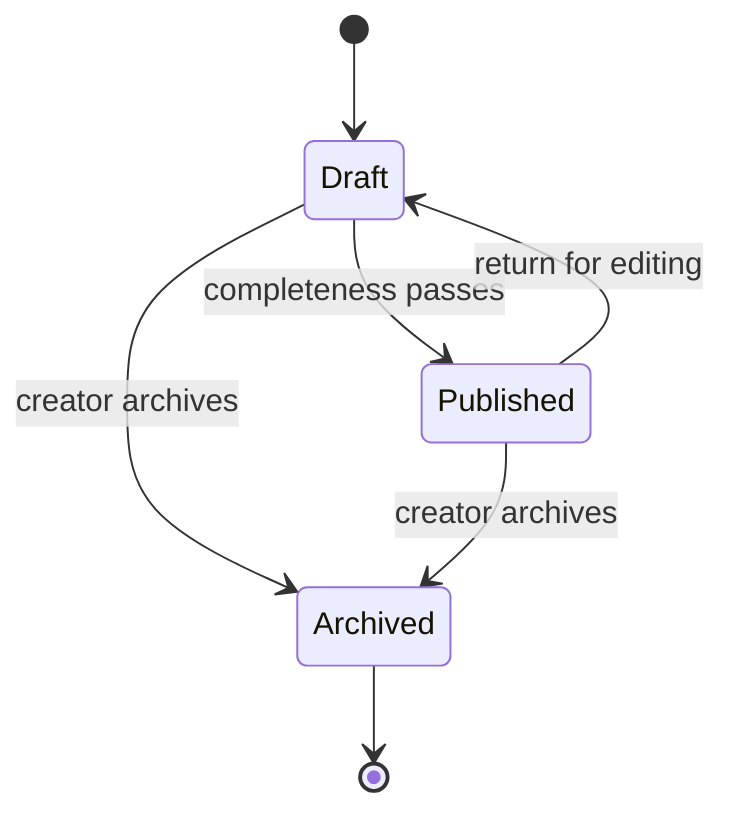

# Agent Souq — Product definition

## Product vision

Agent Souq is a trusted marketplace for practical AI agents. It helps people find a focused agent for a real job, understand what it can and cannot do, save or install it, and evaluate it through verified-use reviews. It gives creators a professional storefront and the minimum tools needed to publish, maintain, and measure listings.

The MVP optimizes for confidence rather than catalogue size: useful search, transparent listing details, clear creator identity, review eligibility, and safe ownership rules matter more than speculative social, payment, or execution features.

## Target users and jobs

| Audience | Primary job | MVP outcome |
| --- | --- | --- |
| Visitor | Find an agent for a task and judge its fit | Search and filter a public catalogue, inspect a listing and creator, then sign up when ready to save or install |
| Member | Keep a personal set of useful agents | Complete onboarding, save listings, view recent history, install free agents, and manage eligible reviews |
| Creator | Publish and improve an agent offering | Activate creator access, draft and publish validated listings, edit or archive them, and view listing-level aggregate activity |
| Future moderator | Keep the marketplace safe | The data model reserves moderation, reports, featured state, and admin roles; a moderation console is not part of this MVP |

## Product principles

1. **Human-reviewable outputs.** Listings describe instructions, capabilities, limitations, and creator ownership; the product never implies that an agent's output is automatically correct.
2. **Trust through real eligibility.** A member can review only an installed agent and cannot review their own listing.
3. **No fake commerce.** Free listings can be installed in the MVP. One-time and subscription prices are discoverable, but purchasing remains unavailable until payment, webhook, and entitlement infrastructure exists.
4. **Creator control with platform safeguards.** Creators own listing content and state changes, while database policies own identity, counters, publication timestamps, and moderation fields.
5. **Useful before configuration.** A clearly labelled, read-only demo mode provides a polished public preview without pretending to persist account activity.
6. **Internationalization-ready.** Layout, copy structure, and data fields avoid assumptions that would block future English/Arabic and LTR/RTL support. English is the MVP interface language.

## MVP scope

### Public marketplace

- A professional landing page with value proposition, featured agents, popular categories, and clear marketplace and creator calls to action.
- A marketplace with keyword search, category and price-type filters, popular/newest/rating/price sorting, URL-persisted state, and pagination.
- Public agent pages with real visual media, description, capabilities, instructions, version, price, aggregate activity, reviews, related agents, and creator attribution.
- Public creator profiles showing identity, verification state, biography, website, and published listings.
- Search-engine metadata, canonical public routes, sitemap, robots rules, social preview, loading states, not-found states, and recoverable errors.

### Identity and onboarding

- Email/password sign-up and sign-in through Supabase Auth.
- Email confirmation callback, persistent server-refreshed sessions, sign-out, password reset request, and password update.
- Generic sign-up and reset responses that do not disclose whether an email already has an account.
- Required onboarding for authenticated product areas, including unique username, full name, optional biography, avatar URL, and website URL.
- Missing-profile recovery when an authenticated user exists without a corresponding application profile.

### Member workspace

- Profile editing.
- Favorite/unfavorite listings.
- Recently viewed listings for signed-in members.
- A personal library of installed free agents.
- Review create/update/delete for eligible installations.
- Dashboard summaries and intentional empty, loading, error, and success states.

### Creator studio

- Explicit creator activation after onboarding.
- Create and edit a listing with name, slug, tagline, description, instructions, category, tags, capabilities, price type, price, visual URLs, demo URL, and semantic version.
- Draft, published, and archived lifecycle states.
- Publish-time completeness checks; incomplete listings remain editable drafts.
- Return a published listing to draft and archive an owned listing.
- Aggregate listing, view, favorite, install, and review counts.
- Public preview of the creator's published listing and a clear preview state for unpublished work.

### Platform foundations

- PostgreSQL migrations, deterministic seed data, and local Supabase configuration.
- Row-level security for all private and owner-controlled records.
- Server-side validation and authorization for every mutation; client-provided user identifiers are never trusted.
- Stable search and sorting, secure error normalization, strict TypeScript, automated tests, and CI verification.

## Core journeys

### Discover and evaluate

1. A visitor lands on Agent Souq and chooses a category or marketplace search.
2. Filters and sorting narrow the catalogue; the URL remains shareable.
3. The visitor opens an agent, inspects media, capabilities, instructions, price model, reviews, and creator identity.
4. Related agents provide a next step when the listing is not a fit.

### Join and build a personal library

1. A visitor signs up and confirms their email when confirmation is enabled.
2. The member completes onboarding and reaches the requested protected destination.
3. The member favorites listings, builds recent-view history, and installs a free agent.
4. The installed free agent appears once in the library even if install is requested repeatedly.
5. The member writes or updates one review for that agent and can later delete it.

### Publish as a creator

1. An onboarded member explicitly activates creator access.
2. The creator starts a draft; identity and ownership come from the authenticated session.
3. The creator completes content and pricing fields and adds at least one cover or gallery visual.
4. Publish validation explains missing or invalid fields without losing the draft.
5. After publication, the listing appears publicly and its creator can monitor aggregate activity.
6. The creator may return the listing to draft for revision or archive it; an archived listing is not publicly discoverable.

## Listing model and lifecycle

Every listing belongs to one category and one creator. It supports up to twelve unique normalized tags, up to twelve unique capabilities, and up to five HTTPS gallery images. Pricing is one of `free`, `one_time`, or `subscription`; currency is USD in the MVP. Non-free types require a positive price, while free listings always have a zero price.

Publication and public visibility are separate concerns. A listing must be both published and moderation-approved to appear in the public catalogue. The MVP seeds approved content and reserves moderation state for a later admin workflow.

## MVP boundaries

The following are deliberately out of scope for the first release:

- Charging a card, managing subscriptions, refunds, invoices, taxes, payouts, or paid entitlements.
- Executing third-party agents inside Agent Souq, proxying prompts, storing secrets for an agent, or metering model usage.
- A full moderation console, automated content scanning, report adjudication, or user suspension UI.
- Social follows, comments, direct messages, creator teams, affiliate programs, coupons, or ranking gamification.
- Native mobile applications, offline support, organization workspaces, and multi-currency pricing.
- Machine translation. The information architecture must remain localization-ready, but the MVP ships in English.

Paid listings remain visible for market validation. Their primary action must state that purchasing is coming soon; it must not create an installation or entitlement.

## Success measures

The MVP is successful when it can be operated and tested as a coherent marketplace, not when it reaches a predetermined revenue target. Initial product metrics are:

- Search-to-detail rate: share of marketplace sessions that open a listing.
- Detail-to-save and detail-to-free-install conversion.
- Percentage of installed free agents receiving a review.
- Creator draft-to-publish completion rate.
- Catalogue quality: percentage of published listings with complete visuals, instructions, capabilities, and valid creator attribution.
- Reliability: successful protected action rate and zero cross-user ownership violations in security tests.

Metrics are aggregate and privacy-conscious in the MVP; no third-party analytics service is required to run locally.

## Release definition

The MVP is ready when all acceptance criteria in `docs/ACCEPTANCE_CRITERIA.md` pass, migrations can reproduce the database from zero, demo mode is honest and usable, configured mode persists all supported actions, and lint, type checking, tests, and a production build complete successfully.
